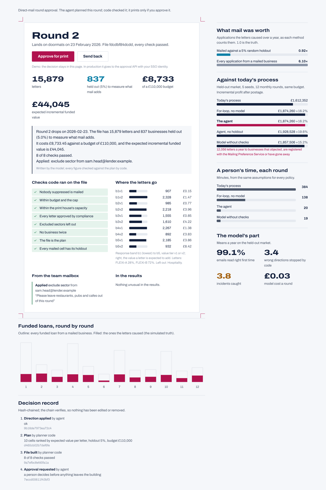

# direct-mail-agent

An agent that plans an SME lender's monthly direct-mail round:
- It plans the round and builds the mailing file with the existing predictive models.
- It learns from results that arrive weeks late.
- A person approves the file before it goes to print.

The agent orchestrates and deterministic code does the work. Every decision goes into a hash-chained record with
its reason.

It is built around the problem in iwoca's Applied AI Engineer (Direct Acquisition) posting, and the runtime is meant
to be reused by the next process:
- memory between runs;
- durable steps;
- tools behind permissions;
- the decision record;
- approvals bound to the exact file a person saw.

Python, SQLite (PostgreSQL in production), dbt on DuckDB (Snowflake in production), FastAPI, Claude through forced
tool calls, React and Framer Motion.



<sub>The approval console (`web/`): the round waiting for a decision, the checks code ran on the file, what the
model read in the team mailbox, what mail was worth, and the decision record. [Phone layout](docs/dashboard-phone.png).</sub>

## Results

Held-out market, run once after the lock: 5 seeds of 12 monthly rounds, about 2.3 million letters a year each, scored
against the simulated market's truth. Full tables in [RESULTS.md](RESULTS.md).

| | Today's process | For-loop (no model) | **The agent** | Model without checks |
|---|---:|---:|---:|---:|
| Incremental profit, 12 rounds | £1,612,352 | £1,874,260 | **£1,874,260 (+16.2%, 5 of 5 seeds)** | £1,857,506 |
| Letters to people who must not get one | 0 | 0 | **0** | 12,056 a year |
| A person's time each round | 384 min | 138 min | **20 min** | 19 min |
| Model cost each round | | | **£0.03** | £0.04 |

- **What mail was worth.** The agent's 5% random holdout put the applications mail caused at 0.92× the truth.
  Counting every application from a mailed business (matchback) put them at 6.1×.
- **The model's part.**
  - It read 99.1% of emails right first time.
  - Code stopped 3.4 wrong directions a year: misread figures, a spoofed "boss" email, and a print house asking to
    ignore the suppression list.
  - After the Head of Direct Acquisition answered the agent's questions, every email had the right effect.
- **Anomalies.**
  - Code caught 3.8 of about 4 incidents a year: a broken tracking link, a results feed with missing rows, a new
    model version, and a competitor's offer.
  - The model diagnosed 2.6 of them and sent each to the right owner. It dismissed most false alarms without
    bothering anyone.
- **Every round.**
  - The decision record verifies.
  - No file reached the print house twice.
  - A final suppression run on print day withdrew about 4,800 letters a year from businesses that objected or became
    customers after the file was approved.

## What I found

Some of this did not work. Finding out why was most of the work.

1. **Holdouts were being mailed the next round.** The first learner measured half the lift that was there. Held-out
   businesses were eligible again 28 days later, so a letter in month two leaked into month one's comparison. A
   suppression rule now keeps them out for the 60-day window (`recent_holdout`).
2. **A Thompson draw is too much exploration at 200,000 letters.** One unlucky draw sent 51,000 letters to a
   low-value cell. Bulk allocation now uses the posterior mean, and Thompson sampling stays where it fits: choosing
   between creatives.
3. **The first held-out run failed.** The first version ran once on a held-out split
   ([commit 427c438](https://github.com/manojrevenkar12-web/direct-mail-agent/commit/427c438)). It earned +4.1% over
   today's process, against +14.3% for learning without holdouts. There were two design flaws:
   - Every cell started from the same prior, ignoring the existing predictive models. In round 1 it filled the cells
     the models rank lowest.
   - Cells kept only for learning had about 110 held-out businesses, too few to tell anything at under 1% response.

   The fix starts every cell from the models' prediction and ranks by the mailed arm. It was developed on the
   development split and run once on a second held-out split, written before the fixed agent ran on anything else.
4. **Measuring costs money.** Without the 5% holdout the agent would earn +19.6% instead of +16.2%, about £54,000 a
   year here. Without it, though, the only measure is matchback, which is six times too optimistic. That is a
   commercial call, so it is one setting (`limits.holdout_share`), with the numbers next to it
   ([ADR 2](docs/adr/0002-rank-by-response-measure-with-holdout.md)).
5. **A for-loop does the planning as well as the agent.** It is the same code, and on every seed it earned the same
   profit. The model earns its place on what a for-loop cannot do:
   - reading "please leave restaurants, pubs and cafes out of this round";
   - telling a seasonal dip from a broken tracking link;
   - writing the brief a person approves from.

   That cut a person's time from 138 to 20 minutes a round
   ([ADR 1](docs/adr/0001-model-reads-code-decides.md)).
6. **Objections go to a rule as well.** The simulated model missed about one objection email in twelve, and each
   miss is a letter to someone who said stop. A regular expression routes them to operations too
   ([ADR 3](docs/adr/0003-objections-by-rule.md)).

## How a round runs

```
results (aggregates) ─┐
models' scores ───────┼─► learn ─► detect anomalies ─► model triages ─► people tasks
team mailbox ─────────┘                 │
                       model reads ─► code checks authority, quote, limits ─► directions
                                        │
          code plans cells under the budget ─► builds the file ─► checks the file
                                        │
                     model writes the brief ─► code checks every figure in it
                                        │
            Head of Direct Acquisition approves file <sha256> ─► code releases it to the print house
                                        │                        (late suppressions withdrawn, once only)
                               decision record, hash-chained, every step
```

| The posting asks for | Where it is |
|---|---|
| Memory that persists between runs | `agentrt/memory.py`: versioned, with where each value came from. `facts/` are written by code from results or by people, and are all the planner reads. `notes/` are the model's own and never decide anything. |
| Task management | `agentrt/tasks.py`: durable steps (a crash resumes without asking the model again) and deduplicated tasks for people. |
| Access to tools, permissions | `agentrt/tools.py` with `config/permissions.toml`: the agent's role cannot release to the printer or write suppressions. Effects take an idempotency key. |
| A record of every decision and why | `agentrt/ledger.py`: a reason is required, and the record is hash-chained, so an edited entry breaks `verify()`. |
| Judgement vs rules the agent can't change | `mailagent/directives.py`: authority from the sender's authenticated role, never from text. `mailagent/mailfile.py`: suppressions, budget, capacity, approved creatives, holdouts. `config/suppressions.yaml`: one definition, compiled to numpy and to SQL, proven equal. |
| Human in the loop approves the file | `agentrt/approvals.py`: bound to the file's sha256, the right role, an expiry. The requester can never approve. `mailagent/api.py` serves the console. |
| Connect to predictive models, data pipelines, channel tools | `mailagent/ports.py`: warehouse (dbt models in `warehouse/`), model scores, results tables, mailbox, compliance register, print house. |
| Run alongside the current process | `mail_eval/`: today's process, a for-loop, the agent and four variants on the same market, seed for seed. |
| How often agents need a person, where they fail, cost, worth | `scripts/evaluate.py` → [RESULTS.md](RESULTS.md): person-minutes and tasks per round, wrong directions stopped, anomalies caught and missed, model cost, incremental profit, measurement against truth. |
| AI coding tools | Built with Claude Code, tests first. Every number in this README comes from a generated report. |

## What this shows and what it does not

The market is a simulation. Businesses have a probability of applying anyway and a separate amount a letter adds.
On top of that it models:
- delays, fatigue and seasonality;
- objections, gone-aways and Mailing Preference Service registrations;
- a response model that scores both together.

The numbers in `config/world.toml` are assumptions chosen to be plausible, not iwoca data.

The people and the model are simulated too. The model makes mistakes at configured rates, so the guardrails' effect
is measurable and repeatable. The same agent runs against Claude through `mailagent/claude.py` (forced tool calls,
the system prompt cached, tested with a fake client). It has not been run against Claude at evaluation scale.

Person-minutes are assumptions (`config/costs.toml`), the same for every policy. The profit comparison does not
depend on them.

## Run it

```bash
pip install -e ".[dev]"
make test        # 43 tests, dbt build on DuckDB included
make demo        # three rounds, printed: what the model read, the plan, the checks, the brief, the release
make dev         # the development split (about 5 minutes on two cores)
cd web && npm ci && npm run dev    # the approval console
DMA_MODEL=claude-sonnet-4-5 PYTHONPATH=src python -m mail_eval.demo demo --model claude   # with ANTHROPIC_API_KEY
```

## Layout

```
src/agentrt/      the reusable runtime: ledger, memory, steps and tasks, tools and permissions, approvals
src/mailagent/    the direct-mail agent: rules, learning, optimiser, mail file and checks, directions, brief,
                  anomalies, Claude adapter, approval API
src/mailworld/    the simulated market, mailbox, people and model (the truth; the agent never imports it)
src/mail_eval/    policies, the harness, the demo
warehouse/        dbt project: staging and the suppression model generated from config/suppressions.yaml
config/           every setting, the market, and the held-out locks
web/              the approval console (React, Framer Motion), feature-first
docs/adr/         three decisions and why
```
